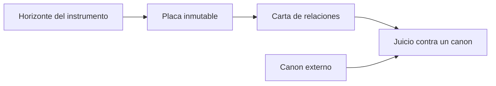

# Núcleo galáctico de sysXray

Dedicatoria, en el documento de núcleo y en una sola frase: este trabajo es para Daniel Domingo Benito, que pedía callar porque no quería saber nada de ordenadores. El método existe para que la explicación quede escrita y sea comprobable.

## Qué hay ya en el directorio

El repo sigue llamándose por dentro `desplantar-auditoria` ([README.md](README.md)). Es una sola exposición congelada, no un sistema en marcha:

- Fuente: `tree /` sin `-a`, 316 MB, 3.233.219 entradas, 306 TSV, visor web. Generada el 2026-10-12.
- Cero nombres que empiecen por `.`. Los 2.375 `brokenOculto` son ceguera del instrumento, no enlaces rotos.
- La auditoría ([data/audit-report.json](data/audit-report.json)) dice `missing: []` para los 17 nombres FHS 3.0, y a la vez registra usr-merge (`/bin` → `usr/bin`, igual `/lib` y `/sbin`) más extras: `snap`, `swap.img`, `lost+found`, `cdrom`, `desplantar.md`.
- Este equipo, leído ahora: GRUB `2.14-2ubuntu2.1`, Secure Boot enabled, lockdown del núcleo en **integrity** (`none [integrity] confidentiality`, man `kernel_lockdown(7)`).

Esa placa se queda. No se rehace el pipeline de 3,2 millones de nodos. Pasa a ser la exposición cero, con su horizonte escrito al lado.

## Realidad medida de este equipo

Leído desde el software, sin abrir la caja. Ubuntu 26.04.1 LTS. Núcleo `7.0.0-38-generic`. Un NVMe Kingston de 1 TB, tabla GPT, dos particiones. El sistema de ficheros de la raíz no está cifrado.

- `nvme0n1p1`, nombre GPT `EFI`, 1 GB, vfat, montada en `/boot/efi`, UUID `DB1C-E88E`. En GRUB: `(hd0,gpt1)`. Ahí solo está el arranque: `shimx64.efi`, `grubx64.efi` y un `grub.cfg` de tres líneas.
- `nvme0n1p2`, nombre GPT `Ubuntu26`, el resto del disco, ext4, montada en `/`, UUID `0ca5347e-1acd-44df-977a-bc57318fd969`. En GRUB: `(hd0,gpt2)`. En esa única partición viven `/boot`, `/usr`, `/etc` y `/home`. No hay disco aparte para el home.
- El `grub.cfg` de la EFI ya hace esto, y es lenguaje de GRUB: `search.fs_uuid 0ca5347e-1acd-44df-977a-bc57318fd969 root`, luego `set prefix=($root)'/boot/grub'`.
- Swap: el fichero `/swap.img` (8 GB, en la misma ext4) se cifra al arrancar con clave aleatoria (`/etc/crypttab`, nombre `swapcrypt`, origen `/dev/urandom`). No guarda el sistema. GRUB no necesita esa clave para leer la partición.
- Secure Boot activado. Lockdown del núcleo en integrity. Eso cierra `/dev/mem` y las órdenes de GRUB que reescriben el arranque. `ls` y `cat` de la ext4 siguen siendo lectura de ficheros.
- En `/` no hay ningún nombre que empiece por punto. Los que `tree` sin `-a` se dejó están en `/home/alexendros` (`.config`, `.local`, `.cache`, `.ssh`, `.bashrc` y el resto de esa carpeta) y cuatro en `/etc` (`.java`, `.pwd.lock`, `.resolv.conf.systemd-resolved.bak`, `.updated`). `/root` es del administrador (`drwx------`); esta sesión no lista su interior.

El cuchillo, en el menú de GRUB, tecla `c` (consola normal, no `grub rescue>`):

```
set pager=1
search --fs-uuid 0ca5347e-1acd-44df-977a-bc57318fd969 --set=root
ls -l ($root)/
ls -l ($root)/home/alexendros/
cat ($root)/etc/os-release
hexdump ($root)/etc/os-release
```

`(hd0,gpt1)` es la EFI. El sistema está en `(hd0,gpt2)`. `cat` vuelca un fichero; el listado es `ls`. El mismo listado de ocultos ya lo ve el sistema arrancado con `ls -la /home/alexendros/`. El reinicio confirma esa carpeta desde GRUB; no descubre un disco distinto.

## Por qué el árbol no sirve de formato

Un árbol es una foto de contención: cada cosa tiene un padre. Sirve para pintar la placa que ya tenemos. No sirve para las dos cosas que el metaproyecto quiere mirar.

- **Sistema en activo.** `/proc`, `/sys`, `/run` y `/dev` cambian mientras se leen. Un montaje, un overlay y un enlace simbólico son relaciones, no hijos. La indentación no puede decir «esto existía hace cinco segundos».
- **Memoria congelada.** La placa de `tree` ya es esa foto, y miente por omisión: sin tamaños, sin dueño, sin ocultos, y un nodo hoja puede ser fichero o directorio vacío (el parser lo marca `f`). Tratar esa foto como el formato del metaproyecto obliga a que todo instrumento futuro se disfraze de glifos `├──`.

## Representación galáctica del ordenador doméstico

Tres palabras, con el sentido que van a tener en el documento de núcleo:

- **Galaxia.** Del griego γαλαξίας, «el círculo lechoso», de γάλα, leche: la Vía Láctea vista como una banda, no como un organigrama. En astronomía es un sistema ligado por gravedad: estrellas, gas, polvo y materia oscura, en órbitas alrededor de un centro común. Una estrella pertenece a la vez al disco, a un brazo y a un cúmulo. La contención es una relación entre otras.
- **Galáctico.** Lo propio de una galaxia, y por extensión lo que se mira a esa escala. Aquí no es un superlativo: nombra la representación cuya unidad es la relación vista desde un horizonte, no el sangrado de un listado.
- **Universo.** Del latín *universum*, «vuelto uno», de *unus* y *vertere*. En cosmología el universo observable acaba en un horizonte: más allá hay realidad que esta observación no alcanza. Lo que el instrumento no ve no se rellena.

**Ordenador doméstico**, el objeto: el que hay en la mayoría de casas que tienen ordenador. Su potencia la limitan el precio y lo que el comercio ofrece, no el techo teórico de la arquitectura. Los recursos materiales de la relación son pantalla, teclado y puntero. El teclado y el puntero piden; la pantalla responde. Toda afirmación del proyecto tiene que ser o bien algo que la pantalla puede mostrar, o bien algo marcado como no observado.

Consecuencia de método, no de metáfora: instrumentos de solo lectura. El haz que mira no se usa para reescribir el arranque.



Tres capas, y ninguna es un esquema previo al dato:

- **Placa.** Captura cruda, inmutable, con instrumento, fecha y horizonte. La de octubre es `instrument: tree`, `horizon: sin-ocultos-sin-metadatos`.
- **Carta.** Relaciones sacadas de placas: contiene, enlaza, monta, niega. El visor actual es una proyección de una sola placa, no la carta.
- **Juicio.** Una regla aplicada después, citando un canon externo. «Cumple» no es una propiedad del disco.

La materia oscura de esta galaxia es lo no observado: ocultos que `tree` no volcó, y lecturas que el lockdown rechaza. El rechazo, copiado literal, es una placa. No es un hueco a tapar.

## LinkML, acotado por las seis objeciones

Las seis objeciones siguen vigentes como prohibiciones, no como veto al lenguaje. El contrato está en [specs/SPEC-sobre-linkml.md](specs/SPEC-sobre-linkml.md). Resumen:

- El esquema tipa el acto (instrumento, horizonte, soporte `asserted | refused | not_in_plate`). Los 2.375 `brokenOculto` son `links_to` + `not_in_plate` + horizonte `no_dotfiles`. No hay slot `exists`.
- `tree_root` es `Plate`. `Statement` no tiene `parent` ni `children`. La relación es un enum.
- `Judgment` exige `Authority.source_url`. Prohibido el slot `compliant`. La tensión de `/bin` son dos afirmaciones y un juicio `desacuerdo`.
- `regime` y `captured_at` obligatorios. Dos placas contradictorias validan las dos.
- `body_uri` apunta al TSV o a la transcripción. LinkML no recorre los 3,2 millones de nodos ni entra en el visor.
- `linkml` es generador de desarrollo. `node tests/run.js` sigue sin paquetes. El pin espera auditoría de la dependencia.

[web/kb-rules.js](web/kb-rules.js) sigue siendo quien clasifica rutas.

## Fase Antigua: cánones y criterios

No hay un solo canon. «¿Se cumple el FHS en su totalidad?» se responde por escrito, y la respuesta de esta placa es no. Los nombres canónicos están; la forma que el FHS 3.0 describe, no.

Cánones, cada uno con qué sí puede juzgar:

- **FHS 3.0** (Linux Foundation, `refspecs.linuxfoundation.org/FHS_3.0/fhs-3.0.html`, citado también por `file-hierarchy(7)`). Nombres y propósito de la raíz. Texto de 2015: `/bin` y `/lib` son directorios.
- **`hier(7)`** de man-pages, en esta máquina. Misma imagen antigua. No es árbitro de un Ubuntu con usr-merge.
- **UAPI.9 / `file-hierarchy(7)`** (systemd 259.5 aquí; spec en uapi-group.org). Canon vivo del árbol de sistema, incluido el usr-merge que freedesktop documenta en «The Case for the /usr Merge».
- **XDG Base Directory** y xdg-user-dirs. Único canon del espacio mutable del usuario. El FHS 3.0 §3.8 dice que la estructura de `/home` es decisión local. Juzgar dotfiles del home contra el FHS es un error de categoría.
- **Red Hat** (guías de administración de RHEL sobre la jerarquía) y **GNU** (manual de coreutils, `ls`). Confirman práctica y herramientas. `tree` no es una herramienta GNU; es el instrumento de la placa cero, y hay que decirlo.
- **Arranque:** manual de GNU GRUB (lockdown desde 2.06, visible en `/usr/share/doc/grub-common/NEWS.gz`), `kernel_lockdown(7)`, y la spec UEFI de Secure Boot.

Criterios de inspección, separados:

- **Raíz de sistema.** Para cada nombre de primer nivel: presente según FHS 3.0, forma según FHS (directorio frente a enlace), forma según UAPI.9, o extra documentado (`snap`, `swap.img`, `lost+found`, `cdrom`, el propio volcado). Severidad la que ya usa la auditoría: info, warn, error. Sin vocabulario moral dentro del dato.
- **Home.** En la placa cero el juicio es «no observable». Cuando llegue una placa con ocultos, el criterio es XDG: config en `~/.config`, datos en `~/.local/share`, caché en `~/.cache`, estado en `~/.local/state`. Lo que una aplicación deja suelto en `~/` es deriva respecto de XDG, no una falta del FHS.

## Secure Boot: qué lectura rechaza

En este equipo el rechazo ya está medido, no conjeturado: Secure Boot activado y lockdown en **integrity**.

Dos horizontes distintos. Conviene no fundirlos.

- **Antes del núcleo (GRUB 2.14, lockdown propio desde GRUB 2.06).** Shim comprueba la firma de GRUB. El lockdown de GRUB prohíbe las órdenes que reescriben la cadena de arranque o tocan memoria y hardware en crudo (`memrw`, accesos de E/S, ACPI, cargar un módulo no firmado, encadenar un binario EFI sin firma). `ls`, `cat` y `hexdump` de un fichero en un sistema de ficheros que el GRUB firmado ya sabe leer no están en esa lista. Si una orden falla, la placa es la línea de error literal (`prohibited`, `lockdown`, `unknown filesystem`). No se apaga Secure Boot para «ver mejor».
- **Después del núcleo (`kernel_lockdown(7)`, modo integrity).** Se niega el acceso a la imagen del núcleo en marcha: `/dev/mem`, `/dev/kmem`, `/dev/kcore`, `/dev/ioports`, debugfs, kprobes, módulos o kexec sin firma, hibernación sin cifrar. El mensaje es `Lockdown: X: Y is restricted`. No niega `ls -la /` ni un `cat` de `/etc/os-release`. Los ocultos que faltan en la placa cero los ocultó `tree` sin `-a`, no Secure Boot.

La conjetura que hay que anunciar, separada en dos frases que cualquiera pueda comprobar: Secure Boot no esconde los nombres que empiezan por punto. Secure Boot sí rechaza la lectura de la memoria y de la imagen del núcleo, y las órdenes de GRUB que servirían para sustituir lo que la firma acaba de autorizar.

## Órdenes para la siguiente placa (las introduces tú)

GRUB no habla bash ni sh POSIX. Tiene su propia lista cerrada de órdenes. No hay tuberías, ni `find`, ni `tree`. Por eso un volcado «con capas de procesado» no cabe dentro de GRUB: GRUB solo emite la placa; la estructura, la validación y la clasificación ocurren después, en este repo, como ya hacen `parse.js`, `kb-rules.js` y `audit.js`.

Las órdenes concretas están en «Realidad medida». Resumen de lo que el plan genérico tenía mal y queda sustituido:

- La raíz ext4 no está cifrada. Buscar el UUID `0ca5347e-1acd-44df-977a-bc57318fd969`. La partición del sistema es `(hd0,gpt2)`.
- `ls ($root)/home/` solo enseña el directorio `alexendros`. Los ocultos están en `ls -l ($root)/home/alexendros/`.
- `ls -la /` en el sistema ya arrancado no tapa el agujero: en `/` no hay nombres con punto. El listado que falta en la placa de `tree` es `ls -la /home/alexendros/`.

`cat` vuelca un fichero. El listado es `ls`. Si una orden responde `prohibited` o `unknown filesystem`, esa línea es la placa. En este disco, un filesystem desconocido al hacer `ls (hd0,gpt2)/` sería un fallo del módulo, no un cifrado de la raíz.

## Qué se escribe al cerrar este plan

Al ejecutar, tres piezas primero, según el mapa pedido. El contrato ya está escrito en [specs/SPEC-sobre-linkml.md](specs/SPEC-sobre-linkml.md); el modo plan bloqueó el `.txt` y el HTML. Sin tocar los TSV, sin runtime de LinkML en el visor, sin desactivar Secure Boot. Instalar el paquete `linkml` se pregunta antes, con auditoría de la dependencia.

- `SPECLinkML-sysXray.txt` en la raíz: copia normativa de la spec.
- [LinkML/LinkML.html](LinkML/LinkML.html): dossier de las seis restricciones, con el caso `/bin`, enlazando a las fichas.
- `docs/`: ocho fichas (`fhs-3.0`, `hier-7`, `uapi-file-hierarchy`, `xdg`, `gnu`, `redhat`, `secure-boot-lockdown`, `grub-ordenes`). Cita y URL, no el manual entero.
- [docs/nucleo.md](docs/nucleo.md): nombre, etimología, ordenador doméstico, tres capas, el sobre, dedicatoria.
- [docs/fase-antiguo.md](docs/fase-antiguo.md): tabla de cánones en prosa con viñetas, criterios de raíz y de home, veredicto de la placa cero.
- [docs/horizonte-arranque.md](docs/horizonte-arranque.md): Secure Boot, lockdown de GRUB, lockdown del núcleo, órdenes de arriba, y la frase de que GRUB no es bash.
- Una sección nueva en [DATA-CONTRACT.md](DATA-CONTRACT.md): formato de `data/plates/` (un fichero por captura, cabecera con instrumento y horizonte, cuerpo literal). Sin placa de ejemplo inventada: la primera la pones tú.
